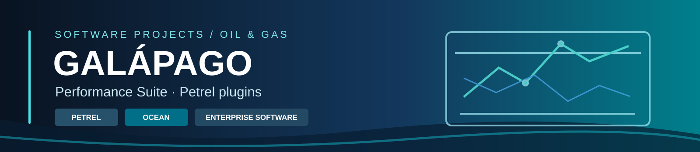
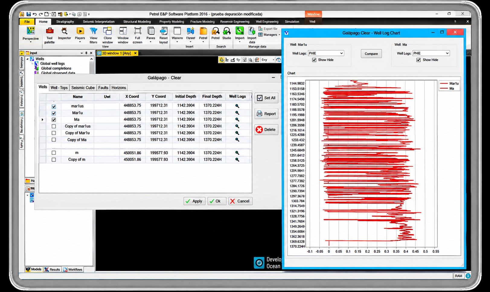
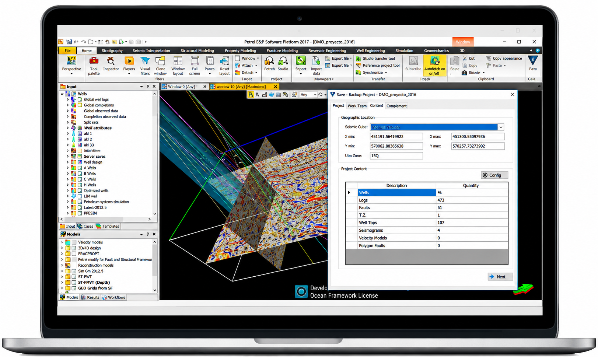

# Galápago Performance Suite
### Caso de estudio profesional · Extensiones para Petrel

**Diseño, dirección de desarrollo y programación de dos productos de software especializado para la gestión de información técnica en proyectos de administración de yacimientos.**

**Productos:** [Galápago Clear](docs/GALAPAGO-CLEAR.md) · [Galápago Save](docs/GALAPAGO-SAVE.md)  
**Entorno de integración:** Petrel (Schlumberger)  
**Tecnologías de implementación:** C#, .NET y Ocean SDK  
**Formación relacionada:** capacitación/certificación Ocean de Schlumberger.

> **Tipo de repositorio:** caso de estudio histórico y documentación funcional. **No contiene código fuente, instaladores, SDK, datos petroleros ni componentes propietarios** de Petrel, Ocean o los productos Galápago.
## Contexto y problema

**Galápago Performance Suite** se presentó como una línea de herramientas de Plenumsoft para complementar la plataforma Petrel mediante plugins que integran algoritmos o automatizan procesos.

La documentación histórica identifica dos necesidades:

- **Depuración y exploración de información técnica:** proyectos con elementos repetidos y tiempos elevados de identificación y limpieza de información.
- **Resguardo y documentación de proyectos:** riesgo de pérdida de información, documentación dispersa y dificultad para localizar variables técnicas.

## Productos desarrollados

| Producto | Problema abordado | Capacidades documentadas |
| --- | --- | --- |
| **[Galápago Clear](docs/GALAPAGO-CLEAR.md)** | Información repetida y depuración laboriosa en proyectos Petrel. | Identificación de variables repetidas; consulta de pozos, cimas, cubos sísmicos, fallas y horizontes; comparación de registros geofísicos de dos pozos. |
| **[Galápago Save](docs/GALAPAGO-SAVE.md)** | Resguardo y organización de información técnica de proyectos. | Automatización del proceso de resguardo; fichas técnicas y reportes; documentación complementaria; georreferenciación; exportación documental. |

### Galápago Clear



*Imagen de presentación. Si se utiliza la versión reconstruida con IA, los textos y valores de la interfaz pueden diferir del material histórico.*


El plugin permitía consultar información del proyecto sin recorrer manualmente las carpetas del panel *Input*, identificar ciertos elementos repetidos y comparar registros geofísicos de dos pozos desde una ventana propia.

[Leer el caso de estudio de Clear →](docs/GALAPAGO-CLEAR.md)

### Galápago Save



*Imagen de presentación. Si se utiliza la versión reconstruida con IA, los textos y valores de la interfaz pueden diferir del material histórico.*


El plugin orientaba el resguardo de proyectos de administración de yacimientos, incluyendo documentación técnica, fichas, reportes y archivos complementarios, además de datos de georreferenciación.

[Leer el caso de estudio de Save →](docs/GALAPAGO-SAVE.md)

## Mi participación: liderazgo de producto y desarrollo técnico

**Rol:** Product Owner y líder del producto, con participación directa en el desarrollo.

Mi participación comenzó antes de la programación. Realicé personalmente el **levantamiento de requerimientos**, concebí una propuesta inicial de solución —que esbocé durante una estancia de trabajo en un hotel— y la **presenté ante directivos de PEMEX**. De ese proceso surgieron las propuestas de **Galápago Clear** y **Galápago Save**.

Posteriormente asumí responsabilidades de **Product Owner y liderazgo del producto**, dirigí a un **equipo multidisciplinario de tres profesionales (dos ingenieros en sistemas y una ingeniera geofísica)** y colaboré activamente en la programación de las extensiones con **C#, .NET y Ocean SDK**.

El recorrido profesional abarcó:

1. **Descubrimiento:** levantamiento directo de necesidades y problemas operativos.
2. **Conceptualización:** diseño de una solución y definición de los dos productos.
3. **Presentación ejecutiva:** exposición de la propuesta ante directivos de PEMEX.
4. **Liderazgo de producto:** coordinación del trabajo del equipo de ingeniería y orientación funcional.
5. **Implementación:** participación práctica en el desarrollo de los plugins integrados con Petrel.

## Tecnologías utilizadas

- **C#:** lenguaje de programación de los dos plugins.
- **.NET:** plataforma de desarrollo utilizada.
- **Ocean SDK:** kit de desarrollo empleado para integrar las extensiones con Petrel.
- **Petrel:** plataforma anfitriona de las herramientas.

## Enfoque técnico

```text
Usuarios de Petrel
       |
       v
Plataforma Petrel
       |
       +-- Galápago Clear
       |     +-- Consulta y detección de elementos repetidos
       |     +-- Exploración de variables del proyecto
       |     +-- Comparación de registros de pozo
       |
       +-- Galápago Save
             +-- Proceso de resguardo
             +-- Ficha técnica y reportes
             +-- Documentos complementarios
             +-- Georreferenciación
```

*Esquema funcional. No representa la arquitectura interna ni las APIs específicas de implementación.*

Ver [fuentes, límites y pendientes](docs/FUENTES-Y-ALCANCE.md).

## Propiedad intelectual y alcance

Este repositorio es una **descripción de experiencia profesional**, no un proyecto open source ni una distribución de productos de Plenumsoft o Schlumberger. Los nombres de productos y marcas pertenecen a sus respectivos titulares. No se declara afiliación actual ni autorización de distribución.

---

[← Portafolio profesional](https://github.com/isaiassolis)
