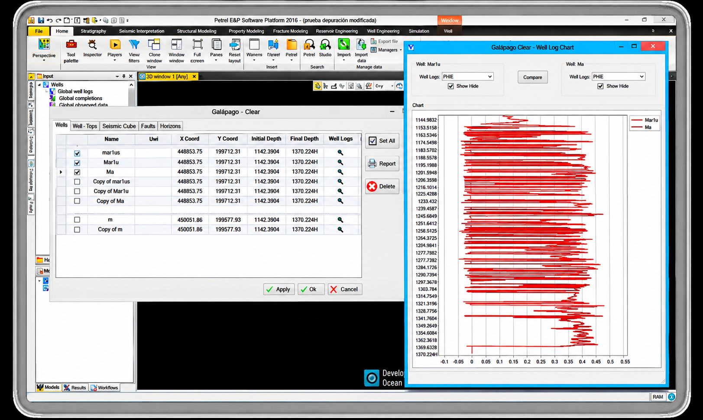

# Galápago Clear

**Exploración y depuración de información técnica en Petrel**

*Recreación visual de presentación; puede diferir de la interfaz original.*

## El desafío

Los proyectos de administración de yacimientos pueden acumular elementos duplicados y grandes volúmenes de información sobre pozos, cimas, fallas, horizontes y cubos sísmicos. Localizar y comparar estos elementos manualmente consume tiempo y dificulta la revisión de los datos.

## La solución

Desarrollamos **Galápago Clear** como una extensión para Petrel orientada a facilitar la consulta y depuración de información desde una interfaz integrada.

Entre sus funciones se encontraban:

- Identificación de pozos y cimas de pozo repetidos.
- Selección y eliminación de elementos sin tener que recorrer individualmente el panel *Input*.
- Consulta de cubos sísmicos, fallas y horizontes.
- Comparación de registros geofísicos de dos pozos desde una ventana del plugin.
- Consulta de propiedades y preparación de reportes en formatos como DOC y PDF.

## Mi participación

Participé en la definición de la solución, el liderazgo del equipo y el desarrollo de los plugins con **C#, .NET y Ocean SDK**, integrados en **Petrel**.

El objetivo fue **simplificar el trabajo de exploración y depuración de datos técnicos**, poniendo herramientas frecuentes al alcance de los especialistas.

[← Volver a Galápago Performance Suite](../README.md)
