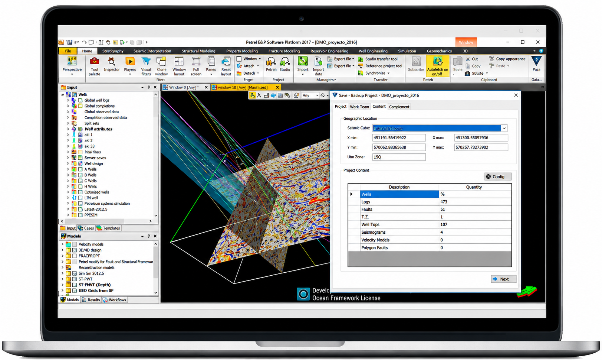

# Galápago Save

**Resguardo y documentación de proyectos de administración de yacimientos**

*Recreación visual de presentación; puede diferir de la interfaz original.*

## El desafío

El trabajo con proyectos de yacimientos requiere conservar información técnica y documentación complementaria. Preparar resguardos, localizar variables y reunir archivos de distintas fuentes puede convertirse en una tarea repetitiva y propensa a omisiones.

## La solución

Desarrollamos **Galápago Save** como una extensión para Petrel orientada a organizar el resguardo de proyectos y facilitar la preparación de documentación asociada.

Su diseño contemplaba:

- Automatización del proceso de resguardo.
- Generación de fichas técnicas y reportes del proceso.
- Incorporación de imágenes, mapas, presentaciones y otros documentos complementarios.
- Inclusión de información de georreferenciación del proyecto.
- Exportación de documentos en formatos como DOC, PDF y XLS.
- Un flujo guiado para facilitar la preparación del resguardo.

## Mi participación

Participé en el levantamiento de requerimientos, la definición del producto y el desarrollo de las extensiones con **C#, .NET y Ocean SDK**, además de liderar al equipo involucrado.

Galápago Save buscaba hacer **más ordenado y eficiente el resguardo de información técnica**, manteniéndolo dentro del entorno de trabajo de los especialistas.

[← Volver a Galápago Performance Suite](../README.md)
